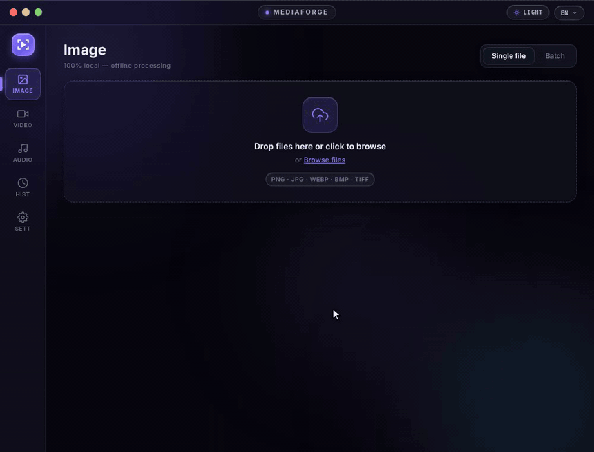

<div align="center">

# Kompri

**Local, fast, and private media converter**

*Kompri (formerly MediaForge)*

[](https://github.com/Hugodlg91/Kompri/releases)
[](https://github.com/Hugodlg91/Kompri/actions/workflows/ci.yml)
[](https://github.com/Hugodlg91/Kompri/releases)
[](https://tauri.app)

<br />



</div>

---

## What is Kompri?

Kompri is a desktop application that converts images, videos, and audio files **entirely on your machine** — no upload, no internet connection required, no account to create, no ads.

It is designed for anyone who needs reliable, fast media conversion without sacrificing privacy or having to deal with bloated web tools or watermarks.

---

## Installation & First Launch

Download the latest installer for your platform from the [**Releases**](https://github.com/Hugodlg91/Kompri/releases/latest) page:

- **Windows**: `Kompri_1.2.2_x64-setup.exe` (recommended) or `Kompri_1.2.2_x64_en-US.msi`
- **macOS (Apple Silicon)**: `Kompri_1.2.2_aarch64.dmg`
- **Linux**: `Kompri_1.2.2_amd64.AppImage`, `Kompri_1.2.2_amd64.deb` or `Kompri-1.2.2-1.x86_64.rpm`

> [!NOTE]
> **First-launch security warning (Windows SmartScreen & macOS Gatekeeper)**
> Kompri is an independent, free project and its binaries are not signed with a paid commercial code-signing certificate. Your OS will display a standard warning the very first time you launch it:
>
> - **Windows (SmartScreen — *"Windows protected your PC"* / *"Windows a protégé votre ordinateur"*)**:
>   Click **More info** (*« Informations complémentaires »*) → **Run anyway** (*« Exécuter quand même »*).
> - **macOS (Gatekeeper — *"Kompri cannot be opened because the developer cannot be verified"* / *"est endommagé"*)**:
>   Move `Kompri.app` to `/Applications`, then either:
>   - Run in Terminal: `xattr -cr /Applications/Kompri.app`
>   - Or **Right-click → Open** on `Kompri.app` (or allow it in **System Settings → Privacy & Security → Open Anyway**).

### Upgrading from MediaForge (v1.2.1 and earlier)

MediaForge was renamed **Kompri** in v1.2.2. Your settings and conversion history are kept on every platform (the app identifier `com.mediaforge.app` did not change).

- **Windows (`.exe` installer)**: just run `Kompri_1.2.2_x64-setup.exe`. It silently uninstalls MediaForge first (program files, Start Menu and Desktop shortcuts, old `MediaForge` right-click menu) without touching your settings or history. If the right-click menu was enabled, it comes back as **Kompri** the first time Kompri starts. A MediaForge shortcut you pinned to the taskbar must be pinned again.
- **Windows (`.msi`)**: `Kompri_1.2.2_x64_en-US.msi` upgrades an existing MediaForge `.msi` install in place. Do not mix the two formats: if you installed MediaForge with the `.exe`, use the Kompri `.exe` (and vice versa), otherwise uninstall MediaForge from *Settings → Apps* first.
- **macOS**: the new `Kompri.app` does **not** replace `MediaForge.app` (different app name). After installing Kompri, drag `/Applications/MediaForge.app` to the Trash. Your settings are shared and stay in place.
- **Linux**: the `.deb` / `.rpm` package name changed, so the MediaForge package is not removed automatically. Remove it with your package manager (for example `dpkg -l | grep -i forge` to find its name, then `sudo apt remove <name>`). AppImage users can simply delete the old `MediaForge_*.AppImage`.

---

## Features

### 🖼️ Images
- Formats: **PNG, JPG, WEBP, BMP, TIFF**
- Resize with aspect-ratio lock (custom dimensions or presets: 50%, 25%, 720p, 1080p)
- Adjustable quality for JPG (1–100); WEBP uses lossless encoding
- Transparent images are composited onto a white background when converted to JPG
- Single file or batch conversion

### 🎬 Video & 1-Click "Target Size" Compression
- Formats: **MP4, MKV, AVI, MOV, WEBM**
- Standard options: resolution, video codec, bitrate
- **1-Click "Target Size" Mode**:
  - Built-in presets for **Discord (10 MB)**, **WhatsApp (16 MB)**, **Gmail (25 MB)**, plus **Custom MB** (default preset sizes are customizable in Settings)
  - **2-Pass H.264 / H.265 encoding** with a **95% container safety budget** (`1 MB = 1,000,000 B`) so output files strictly stay under platform upload limits
  - **Automatic resolution & FPS downscaling** (orientation-aware for both landscape and 9:16 portrait videos) with live pre-conversion quality/resolution estimate
  - Automatic **-10% bitrate retry** if an encode ever exceeds the target size, and instant **copy/remux** when the source file is already below the target
- Single file or batch conversion with real-time progress (`Pass 1/2` & `Pass 2/2`) and cancel support

### 🎵 Audio
- Formats: **MP3, FLAC, WAV, OGG, AAC, M4A**
- Options: bitrate, sample rate, audio normalization
- Single file or batch conversion
- Real-time progress with cancel support

### 🖱️ Windows Explorer Right-Click Context Menu & CLI
- **Native cascading context menu** on Windows (`.mp4`, `.mov`, `.mkv`, `.avi`, `.webm`, `.png`, `.jpg`, `.jpeg`, `.webp`, `.bmp`, `.tiff`, `.mp3`, `.wav`, `.flac`, `.ogg`, `.aac`, `.m4a`) registered under `HKCU\Software\Classes\SystemFileAssociations` (**no administrator rights required**)
- One-click actions directly from Windows Explorer:
  - *Compress for Discord (10 MB)* / *WhatsApp (16 MB)* / *Gmail (25 MB)*
  - *Convert to MP4 / MP3 / JPG / PNG / WEBP*
  - *Open in Kompri…*
- **Compact 420×220 mini-window** for context-menu conversions with auto-close on completion, single-instance multi-file queue forwarding, and clean NSIS uninstall hook
- **Known Windows 11 limitation**: Because Windows 11's modern top-level context menu requires a paid EV code-signing certificate (`IExplorerCommand` + Sparse MSIX identity), Kompri's cascading menu appears under the classic context menu (**`Shift + F10`** or **"Show more options"**).

### 💻 Command-Line Interface (CLI)
Kompri can also be automated from a terminal or script:

```bash
# Compress video(s) to a platform preset (discord | whatsapp | gmail)
Kompri.exe --action compress --preset discord -- "C:\Videos\clip.mp4"

# Convert media file(s) directly to a target format (mp4 | mp3 | jpg | png | webp)
Kompri.exe --action convert --to mp4 -- "C:\Videos\clip.mov"
Kompri.exe --action convert --to webp -- "C:\Images\photo.png"

# Open file(s) directly inside the Kompri converter UI
Kompri.exe --action open -- "C:\Audio\track.wav"

# Headless / synchronous execution for scripts (--wait / --headless)
Kompri.exe --action compress --preset whatsapp --wait -- "C:\Videos\clip.mp4"
```

### ✨ General
- **Native drag & drop** — drop files directly onto the converter
- **Conversion history** — browse, filter, search, and re-open past conversions
- **Light / dark theme** — Liquid Glass design system, persisted locally
- **5 languages** — French, English, Spanish, German, Portuguese (auto-detected from system)
- **100% offline** — no telemetry, no network requests, no data leaves your machine

---

## Tech Stack

| Layer | Technology |
|---|---|
| Desktop framework | [Tauri v2](https://tauri.app) |
| Frontend | React 19 + TypeScript + Vite |
| Styling | Tailwind CSS v4 (Vite plugin) |
| i18n | i18next + react-i18next |
| Video & audio conversion | FFmpeg (bundled sidecar) |
| Image conversion | Rust `image` crate v0.25 |
| Settings, history & single-instance | `tauri-plugin-store`, `tauri-plugin-single-instance`, `winreg` (Windows) |
| Tests | Vitest (55 tests) + Rust `#[cfg(test)]` (65 tests) |

---

## Getting Started (Development)

### Prerequisites

- **Node.js** ≥ 20
- **Rust** (stable toolchain) — [rustup.rs](https://rustup.rs)
- **FFmpeg & FFprobe binaries** placed in `src-tauri/binaries/`
  → See [`src-tauri/binaries/README.md`](src-tauri/binaries/README.md) for naming conventions and download instructions

### Setup

```bash
# Install frontend dependencies
npm install

# Start the dev server (hot-reload)
npm run tauri dev

# Run unit tests (Vitest + Rust)
npm test
cd src-tauri && cargo test

# Regenerate with npm run record-demo
npm run record-demo
```

Regenerate with `npm run record-demo` (requires Playwright Chromium or `CHROME_PATH` and `ffmpeg` in `PATH` — see [`scripts/record-demo/README.md`](scripts/record-demo/README.md)).

### Production Build

```bash
npm run tauri build
```

Generates native installers in `src-tauri/target/release/bundle/`:

| Platform | Output |
|---|---|
| Windows | `Kompri_1.2.2_x64-setup.exe` (NSIS) + `Kompri_1.2.2_x64_en-US.msi` |
| macOS | `Kompri_1.2.2_aarch64.dmg` |
| Linux | `Kompri_1.2.2_amd64.AppImage` + `Kompri_1.2.2_amd64.deb` |

> **Note:** Each platform can only build its own native installer. Use a CI/CD pipeline (e.g. GitHub Actions) to build all three simultaneously.

---

## Project Structure

See [`arbo.md`](arbo.md) for the full annotated file tree.

---

## License

MIT + Commons Clause — © 2026 VladimirWRLD
Free to use and contribute — commercial resale prohibited.

---

## Third-Party Licenses

Kompri bundles standalone **FFmpeg** and **FFprobe** binaries executed as external sidecar processes (`tauri-plugin-shell`) for video and audio processing. Because these prebuilt FFmpeg/FFprobe binaries are compiled with `--enable-gpl --enable-version3` (including `libx264` and `libx265`), they are governed by the **GNU General Public License v3.0 (GPLv3)**.

See [`THIRD_PARTY_NOTICES.md`](THIRD_PARTY_NOTICES.md) for platform-specific versions, build providers, and corresponding source code URLs, and [`licenses/FFmpeg-GPLv3.txt`](licenses/FFmpeg-GPLv3.txt) for the full GPLv3 license text.
